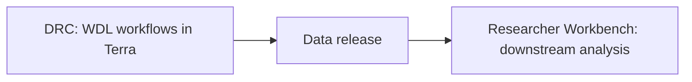

# Getting started

Step-by-step instructions for installing and running the code for each phase of the project.

## How the analysis is organized

Phase 1 and Phase 2 are organized the same way. The *All of Us* Data and Research Center (DRC) processes the sequencing data in [Terra](https://app.terra.bio/) with WDL workflows: alignment, assembly, variant calling, cohort merging, the reference panel, imputation, and callset QC. The DRC then releases the processed data to the *All of Us* [Researcher Workbench](https://workbench.researchallofus.org), where all further downstream analysis takes place in notebooks and scripts.



Each phase directory follows the same layout, split by where the code runs:

| Path | Contents | Runs in |
|------|----------|---------|
| `phaseN/terra/wdl/` | WDL workflows, one directory per workflow | Terra |
| `phaseN/terra/notebooks/` | Callset QC notebooks | Terra |
| `phaseN/rw/notebooks/` | Phenotype, figure, and table notebooks | Researcher Workbench |
| `phaseN/rw/scripts/` | Console scripts for downstream analyses | Researcher Workbench |

The steps below use Phase 1 paths and workflows as examples. Phase 2 code is not in this repository yet; once it is, the same steps apply under `phase2/`. The science behind each Phase 1 stage (inputs, outputs, and Methods sections) is in [phase1/PIPELINE.md](phase1/PIPELINE.md).

## About Terra and the Researcher Workbench

### Terra

[Terra](https://app.terra.bio/) is a cloud platform for biomedical data analysis on Google Cloud. It runs WDL workflows on the Cromwell engine and hosts Jupyter notebooks, with data organized in workspace tables and buckets. If you are new to Terra:

- The three Quickstart tutorials, which use a small practice workspace: [1. Data tables](https://support.terra.bio/hc/en-us/articles/23740086603547-Terra-GCP-Quickstart-1-Data-tables), [2. Workflows](https://support.terra.bio/hc/en-us/articles/23740210297115-Terra-GCP-Quickstart-2-Workflows), and [3. Notebooks](https://support.terra.bio/hc/en-us/articles/23740310333851-Terra-GCP-Quickstart-3-Notebooks)
- [Overview: Running workflows in Terra](https://support.terra.bio/hc/en-us/articles/360036379771-Overview-Running-workflows-in-Terra)
- [How to import a workflow and its parameter file from Dockstore into Terra](https://support.terra.bio/hc/en-us/articles/360038137292-How-to-import-a-workflow-and-its-parameter-file-from-Dockstore-into-Terra), used in [step 2a](#2a-on-terra)
- [Terra Support](https://support.terra.bio/hc/en-us) for everything else

### Researcher Workbench

The *All of Us* [Researcher Workbench](https://workbench.researchallofus.org) is where registered researchers analyze *All of Us* data. Genomic data, including long-read whole-genome sequencing, are in the Controlled Tier, which requires [registration](https://www.researchallofus.org/register/) and Controlled Tier training. If you are new to the Workbench:

- [Researcher Workbench Getting Started Guide](https://support.researchallofus.org/hc/en-us/articles/41981050556564-Researcher-Workbench-Getting-Started-Guide): logging in, workspaces, analysis tools, and billing
- [Featured Workspaces](https://support.researchallofus.org/hc/en-us/articles/360059633052-Featured-Workspaces): tutorial workspaces, including the "How to Work with All of Us Genomic Data" notebook
- [How the All of Us genomic and multi-omics data are organized](https://support.researchallofus.org/hc/en-us/articles/49999549117588-How-the-All-of-Us-Genomic-and-multi-omics-data-are-organized), including the long-read data
- [Getting Started and What to Know About Costs](https://support.researchallofus.org/hc/en-us/articles/360039539411-Getting-Started-and-What-to-Know-About-Costs)
- The [User Support Hub](https://support.researchallofus.org/hc/en-us) for everything else

**Workbench 1.0 and 2.0.** The Phase 1 notebooks were developed on Researcher Workbench 1.0. The current Researcher Workbench 2.0 runs on Verily Workbench. The notebooks are still correct, but some resources, such as data locations and menu options, may have moved; the Getting Started Guide and User Support Hub describe the current locations.

## What you can run, and where

| You have | You can |
|----------|---------|
| Only this repository | Validate every workflow ([step 1](#1-get-the-code-and-validate-the-workflows)). Run any workflow on your own long-read data with Cromwell ([step 2b](#2b-outside-terra-cromwell)). Run downstream scripts that use public data, such as the Phase 1 eQTL and GWAS-catalog LD analyses on 1000 Genomes and MAGE data, once imputed SV genotypes are available ([step 5](#5-run-the-console-scripts)). |
| A [Terra](https://app.terra.bio/) account with a billing project | Run the workflows at cohort scale ([step 2a](#2a-on-terra)). |
| *All of Us* [Controlled Tier access](https://www.researchallofus.org/register/) | Run the downstream analyses on the released data (steps 4–5). Individual-level sequencing, EHR, and derived callsets exist only in Terra and the Researcher Workbench. |

## 0. Prerequisites

| Needed for | Requirement |
|------------|-------------|
| Validating or running WDLs outside Terra | Java 17+ and [Cromwell/womtool](https://github.com/broadinstitute/cromwell/releases) (the CI uses release 87) |
| Running WDLs on Terra | A Terra account, a billing project, and a workspace |
| Released data and downstream analyses | *All of Us* Researcher Workbench registration with Controlled Tier access |
| Console scripts in `phaseN/rw/scripts/` | [conda](https://docs.conda.io/) or [mamba](https://mamba.readthedocs.io/) |

Notebooks need no install. Terra and Researcher Workbench virtual machines come with the Python and R packages they use, and a notebook installs any missing package itself.

## 1. Get the code and validate the workflows

```bash
git clone https://github.com/all-of-us/long-reads-public-codebase.git
cd long-reads-public-codebase
scripts/validate_wdls.sh
```

The script runs `womtool validate` on every workflow entry point under `phaseN/terra/wdl/` (43 for Phase 1). Pass the path to a womtool jar if `womtool` is not on your `PATH`: `scripts/validate_wdls.sh womtool-87.jar`. The same check runs in CI.

Each workflow lives in `phaseN/terra/wdl/<upstream>/<Workflow>/`. That directory contains `<Workflow>.wdl` (the entry point), `repo/` (the imported WDLs, laid out as in the upstream repository), `SOURCE.txt` (upstream repository, branch, Dockstore entry, and any local patches), and `example_inputs.json` (example inputs from a production run). See [phase1/terra/wdl/README.md](phase1/terra/wdl/README.md).

## 2. Run the workflows

Run the workflows in the order of the [launch table](#launch-order) below. Each step writes files that the next step reads.

### 2a. On Terra

This is how the DRC produced the callsets.

1. Create a Terra workspace.
2. Import each workflow from Dockstore using the `dockstore:` URL in its `SOURCE.txt`, at the branch in the `branch:` field. Terra imports WDLs by URL, so the local copies (which use relative imports) cannot be pasted in directly. Where a Dockstore entry is no longer published, use [2b](#2b-outside-terra-cromwell) with the local copy.
3. Fill in the inputs on the workflow's configuration page. Example values are in the `example_inputs.json` file next to each workflow. Copy the fixed values (thresholds, tool arguments, Docker images), and point file inputs at your own data or at the outputs of the previous step. See [Example inputs](phase1/terra/wdl/README.md#example-inputs).
4. Launch. For a small test, keep the same order but restrict the sample and chromosome scatters (for example, one chromosome and a handful of samples).
5. Run the callset QC notebooks in `phaseN/terra/notebooks/` in the same workspace ([Phase 1](phase1/terra/notebooks/README.md)).

### 2b. Outside Terra (Cromwell)

Every entry point runs from its local path, because its imports resolve into the adjacent `repo/` directory:

```bash
womtool inputs phase1/terra/wdl/long-read-pipelines/PBCCSWholeGenome/PBCCSWholeGenome.wdl > inputs.json
java -jar cromwell.jar run phase1/terra/wdl/long-read-pipelines/PBCCSWholeGenome/PBCCSWholeGenome.wdl --inputs inputs.json
```

Edit `inputs.json` before running, or start from the workflow's `example_inputs.json` and replace its `this.` and `workspace.` values with your own files. The workflows were written for Cromwell's Google Cloud backend: tasks pull public Docker images and many inputs are `gs://` paths. Running them elsewhere needs a Cromwell backend with Docker, plus local copies of the reference files. Use Cromwell rather than miniwdl. miniwdl's stricter parser rejects six of the Phase 1 workflows on syntax that Cromwell accepts.

### Launch order

For Phase 1 (stages are described in [phase1/PIPELINE.md](phase1/PIPELINE.md)):

| Step | Stage | Workflows (in order) | Outputs used by the next step |
|------|-------|----------------------|-------------------------------|
| 1 | a | `PBAssembleWithHifiasm`, `PBCCSWholeGenome`, `pav` → `PAV2SVs`, per sample | Aligned BAM, haplotype FASTA, SNV/indel gVCF, SV VCFs (PBSV, Sniffles2, PAV) |
| 2 | a (QC) | `VerifyFingerprintCCSSample`, `SexCheck`, `LongReadsContaminationEstimation`, as needed | QC tables used to exclude samples |
| 3 | b | `TruvariIntrasampleV11` → `GetRegenotypedVcfKanpigV11` → `FilterIntrasampleDevV11` → `FilterAndSplit`, per sample | Filtered SV VCFs, split by chromosome |
| 4 | c | `LRJointCallGVCFs` | Joint SNV/indel VCF |
| 5 | c | `TruvariIntersample` → `ConcatenateChromosomes` → `RemoveSamplesV11` → `GetRegenotypedVcfKanpigMergedV11` → `MergeRegenotypedIntersampleVcf` | Joint SV VCF (`concat_regenotyped.vcf.gz`) |
| 6 | c | `PhysicalPhasing`, per sample | Physically phased SNV/indel and SV VCFs |
| 7 | c | `ChromosomePhasedPanelCreationFromHiPhase` → `ConcatAndEvaluateReduced` | Statistically phased panel and bubble-graph VCF |
| 8 | d | `KAGEPanelWithPreprocessing`, per chromosome | KAGE panel index and count model |
| 9 | d | `KAGECasePerChromosomeFlexscattered`, per srWGS sample | Per-sample genotype VCFs |
| 10 | d | `GLIMPSEBatchedCasePerChromosomeSingleBatch`, per batch | Imputed batch VCFs |
| 11 | d | `HierarchicallyMergeVcfs` | Collision-less imputed srWGS callset |

Steps 3 and 5 are detailed in [callset-integration/README.md](phase1/terra/wdl/callset-integration/README.md). `FilterIntrasampleDevV11` imports a GATK filtering method from FireCloud at launch time and needs HPRC dipcall training VCFs that are not in this repository. `PBCCSWholeGenome` starts from BAMs already aligned with pbmm2 (command in [phase1/SOFTWARE.md](phase1/SOFTWARE.md)).

## 3. Data release to the Researcher Workbench

The Researcher Workbench does not re-run the Terra workflows. The DRC releases their outputs to the Workbench Controlled Tier, and downstream analyses start from that release. For Phase 1, the analyses use:

- Aligned BAMs and haplotype assemblies (assembly figures, CYP2D6, repeat expansions)
- Per-sample and joint SNV/indel and SV VCFs, and the Hail MatrixTables built from the joint gVCFs
- The phased panel and the imputed srWGS callset (PheWAS, disease associations, figures)

Analyses that combine these outputs with public data, such as the Phase 1 eQTL (MAGE expression) and GWAS-catalog LD (1000 Genomes genotypes) analyses, do not need the Workbench. PheWAS and all other EHR analyses do, because they query OMOP tables that exist only there.

## 4. Run the Workbench notebooks

1. Open the workspace named in the manuscript Code availability section.
2. Start a JupyterLab environment in the workspace, as described in the [Getting Started Guide](https://support.researchallofus.org/hc/en-us/articles/41981050556564-Researcher-Workbench-Getting-Started-Guide). Each notebook states the machine size to use, and Hail notebooks need an environment with Hail (Spark) support.
3. Upload and run the notebooks in `phaseN/rw/notebooks/` ([Phase 1 index](phase1/rw/notebooks/README.md)).

The copies in this repository have outputs removed. Data paths are written relative to `AOU_LR_DATA`, an environment variable that the notebooks read but never set. Set it to the location of the released data from step 3 before running a notebook, for example from a Jupyter terminal before starting the kernel, or in a cell of your own:

```python
%env AOU_LR_DATA=gs://your-bucket/path
```

In R notebooks, use `Sys.setenv(AOU_LR_DATA = "gs://your-bucket/path")`. Most notebooks expect a `gs://` location. Two open files with local file functions and expect a local directory instead: `phase1/rw/notebooks/11_sv_disease_associations.ipynb` and `phase1/terra/notebooks/09_hiphase_results.ipynb`. Each notebook's first `AOU_LR_DATA` cell says which kind it expects.

## 5. Run the console scripts

The scripts in `phaseN/rw/scripts/` are the only code that needs an install. For Phase 1, follow the [scripts README](phase1/rw/scripts/AoU_SV_analysis/README.md): create the conda environment, then run sections 1–5 in order. The PheWAS section (5) must run in a Workbench terminal. The other sections run anywhere their inputs are available.

## Known gaps

These parts of the Phase 1 analysis cannot be re-run end to end from this repository:

- **Unpublished workflows.** EvaluateAssemblyHap, SummarizePAVSVs, and SummarizeSnifflesSVs were removed upstream before they could be copied here. See [phase1/terra/wdl/README.md](phase1/terra/wdl/README.md#not-vendored).
- **Exact versions.** Some workflows ran a slightly different commit from the copy here, and PhysicalPhasing, V11HprcAnalysis, and SmallVariantsBasicMetrics have no example inputs. [How closely each copy matches what ran](phase1/terra/wdl/README.md#how-closely-each-copy-matches-what-ran) lists each case.
- **Upstream tools run outside this repository.** CADD-SV and CAVIAR (see the [scripts README](phase1/rw/scripts/AoU_SV_analysis/README.md#install)), plus TRGT, LongTR, ExpansionHunter, and AlphaFold3 (see [phase1/SOFTWARE.md](phase1/SOFTWARE.md)).
- **CYP2D6.** [12_cyp2d6.ipynb](phase1/rw/notebooks/12_cyp2d6.ipynb) contains command-line scripts pasted into cells rather than a runnable sequence.
