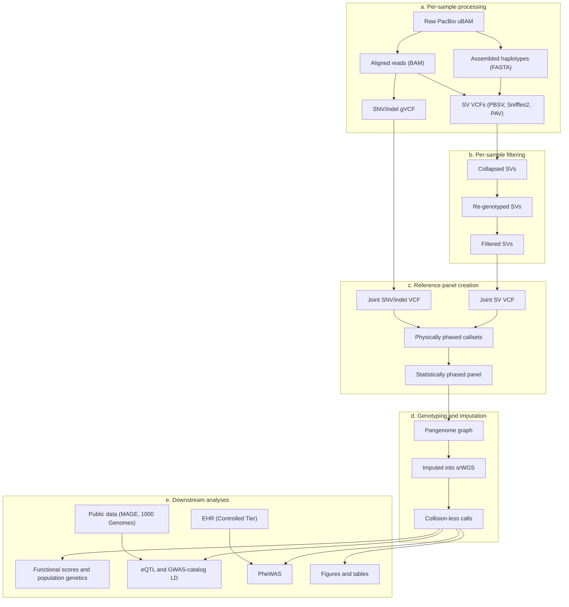

# AoU Long Read Phase 1 pipeline

This guide follows the analysis in **pipeline order**, from raw PacBio HiFi reads to a phased reference panel, short-read genotyping and imputation, and downstream figures and tables. It mirrors Supplementary Fig. 1 and the manuscript Methods. For each stage it gives the inputs and outputs, the workflows in launch order, and the matching Methods sections.

To run these stages, see [GETTING_STARTED.md](../GETTING_STARTED.md). Tool versions are in [SOFTWARE.md](SOFTWARE.md). Workflow links point to the entry points under [terra/wdl/](terra/wdl/README.md).

## Overview

| Stage | Purpose | Primary outputs |
|-------|---------|-----------------|
| [a. Per-sample processing](#a-per-sample-processing) | Align, assemble, and call variants per sample | BAM, FASTA, gVCF, per-caller SV VCFs |
| [b. Per-sample filtering](#b-per-sample-filtering) | Collapse, re-genotype, and filter SVs | Sample-level filtered SV VCF |
| [c. Reference panel creation](#c-reference-panel-creation) | Joint-call, phase, build bubble graph | Statistically phased panel VCF |
| [d. Genotyping / imputation](#d-genotyping--imputation) | Genotype and impute the panel into srWGS | Collision-less imputed VCF |
| [e. Downstream analyses](#e-downstream-analyses--figures) | Interpretation, associations, figures | Notebook and script outputs |

---

## a. Per-sample processing

**Purpose.** For each sample, turn raw PacBio HiFi data into aligned reads, haplotype assemblies, SNV/indel calls, and SV calls.

| Input | Tool | Output |
|-------|------|--------|
| Raw PacBio uBAM | pbmm2 | Aligned reads (BAM) |
| Raw PacBio uBAM / FASTQ | hifiasm | Assembled haplotypes (FASTA) |
| Aligned BAM | DeepVariant | SNV/indel calls (gVCF) |
| Aligned BAM | Sniffles2, PBSV | SV calls (VCF) |
| Assembled FASTA | PAV | SV calls (VCF) |

**Workflows, in launch order.** Run once per sample, or scatter over the cohort.

1. Optional preprocessing: [HiFiBamToFastQ](terra/wdl/long-read-pipelines/HiFiBamToFastQ/HiFiBamToFastQ.wdl), [MergeFastqs](terra/wdl/long-read-pipelines/MergeFastqs/MergeFastqs.wdl)
2. Assembly: [PBAssembleWithHifiasm](terra/wdl/long-read-pipelines/PBAssembleWithHifiasm/PBAssembleWithHifiasm.wdl), then optionally [MapAssemblyContigs](terra/wdl/long-read-pipelines/MapAssemblyContigs/MapAssemblyContigs.wdl)
3. Small variants and read-based SVs: [PBCCSWholeGenome](terra/wdl/long-read-pipelines/PBCCSWholeGenome/PBCCSWholeGenome.wdl) (DeepVariant, PBSV, Sniffles2), summarized with [SummarizeSmallVariants](terra/wdl/long-read-pipelines/SummarizeSmallVariants/SummarizeSmallVariants.wdl)
4. Assembly-based SVs: [pav](terra/wdl/pav-wdl/pav/pav.wdl), then [PAV2SVs](terra/wdl/callset-integration/PAV2SVs/PAV2SVs.wdl)

**Supporting QC (not on the critical path).** [LongReadsContaminationEstimation](terra/wdl/long-read-pipelines/LongReadsContaminationEstimation/LongReadsContaminationEstimation.wdl), [VerifyFingerprintCCSSample](terra/wdl/long-read-pipelines/VerifyFingerprintCCSSample/VerifyFingerprintCCSSample.wdl), [SexCheck](terra/wdl/long-read-pipelines/SexCheck/SexCheck.wdl), [CollectSingleSampleSVvcfMetrics](terra/wdl/long-read-pipelines/CollectSingleSampleSVvcfMetrics/CollectSingleSampleSVvcfMetrics.wdl), [SmallVariantsBasicMetrics](terra/wdl/long-read-pipelines/SmallVariantsBasicMetrics/SmallVariantsBasicMetrics.wdl).

**Methods.** Main: *Read mapping and assembly*, *Variant detection*. Supplementary Fig. 1.

---

## b. Per-sample filtering

**Purpose.** Harmonize multi-caller SV discovery within each sample, re-genotype with Kanpig, and score and filter variants against HPRC assembly truth to produce a sample-level filtered SV VCF.

| Input | Process | Output |
|-------|---------|--------|
| Per-caller SV VCFs (Sniffles2, PBSV, PAV) | truvari collapse | Collapsed SVs (intra-sample VCF) |
| Collapsed VCF + BAM | Kanpig | Re-genotyped, annotated VCF |
| HPRC assemblies → dipcall / bcftools merge | Truth labels for training | HPRC SV VCFs |
| Annotated VCF + HPRC truth | Isolation-forest scoring (GATK ExtractVariantAnnotations / TrainVariantAnnotationsModel) | Filtered SVs (sample-level VCF) |

**Workflows, in launch order.** Run per sample. These are steps 1–4 of the [callset-integration launch order](terra/wdl/callset-integration/README.md).

1. [TruvariIntrasampleV11](terra/wdl/callset-integration/TruvariIntrasampleV11/TruvariIntrasampleV11.wdl) → `truvari_collapsed`
2. [GetRegenotypedVcfKanpigV11](terra/wdl/callset-integration/GetRegenotypedVcfKanpigV11/GetRegenotypedVcfKanpigV11.wdl) → `regenotyped_kanpig`
3. [FilterIntrasampleDevV11](terra/wdl/callset-integration/FilterIntrasampleDevV11/FilterIntrasampleDevV11.wdl) → `v11_scored_kanpig_vcf_gz`
4. [FilterAndSplit](terra/wdl/callset-integration/FilterAndSplit/FilterAndSplit.wdl) → filtered VCFs split by chromosome

Related helpers not on the launch path: [TruvariCollapse](terra/wdl/callset-integration/TruvariCollapse/TruvariCollapse.wdl), [LRMergeSVVCFs](terra/wdl/long-read-pipelines/LRMergeSVVCFs/LRMergeSVVCFs.wdl).

**Methods.** Supplementary Information: *Building a cohort-level SV callset* → *Intra-sample merging*, *Intra-sample filtering*.

---

## c. Reference panel creation

**Purpose.** Joint-call SNVs/indels and SVs across the cohort, phase them physically and statistically, remove colliding alleles, and build a pangenome bubble-graph reference panel (AoU + HPRC; strict SV callset).

| Input | Process | Output |
|-------|---------|--------|
| Per-sample gVCFs | GLnexus | Joint-called SNV/indel VCF |
| Sample-level filtered SV VCFs | truvari collapse + Kanpig (cohort) | Joint-called SV VCF |
| Joint SNV + SV callsets + BAMs | HiPhase | Physically phased SNV and SV callsets |
| Physically phased callsets | Filter, bcftools merge, fix collisions, SHAPEIT4, PanGenie bubbles | Statistically phased panel / pangenome graph VCF |

**Workflows, in launch order.**

1. Joint SNVs/indels: [LRJointCallGVCFs](terra/wdl/long-read-pipelines/LRJointCallGVCFs/LRJointCallGVCFs.wdl)
2. Cohort SV merge (callset-integration steps 5–9): [TruvariIntersample](terra/wdl/callset-integration/TruvariIntersample/TruvariIntersample.wdl) → [ConcatenateChromosomes](terra/wdl/callset-integration/ConcatenateChromosomes/ConcatenateChromosomes.wdl) → [RemoveSamplesV11](terra/wdl/callset-integration/RemoveSamplesV11/RemoveSamplesV11.wdl) → [GetRegenotypedVcfKanpigMergedV11](terra/wdl/callset-integration/GetRegenotypedVcfKanpigMergedV11/GetRegenotypedVcfKanpigMergedV11.wdl) → [MergeRegenotypedIntersampleVcf](terra/wdl/callset-integration/MergeRegenotypedIntersampleVcf/MergeRegenotypedIntersampleVcf.wdl), producing `concat_regenotyped.vcf.gz`
3. Physical phasing, per sample: [PhysicalPhasing](terra/wdl/lrma-aou1-panel-creation/PhysicalPhasing/PhysicalPhasing.wdl)
4. Statistical phasing and bubble-graph panel, per chromosome: [ChromosomePhasedPanelCreationFromHiPhase](terra/wdl/lrma-aou1-panel-creation/ChromosomePhasedPanelCreationFromHiPhase/ChromosomePhasedPanelCreationFromHiPhase.wdl)
5. Concatenate and evaluate: [ConcatAndEvaluateReduced](terra/wdl/lrma-aou1-panel-creation/ConcatAndEvaluateReduced/ConcatAndEvaluateReduced.wdl)

Related helpers not on the launch path: [JointCalling](terra/wdl/sv-merging/JointCalling/JointCalling.wdl), [MergeVCFs](terra/wdl/sv-merging/MergeVCFs/MergeVCFs.wdl), [MergeSVsSNPs](terra/wdl/callset-integration/MergeSVsSNPs/MergeSVsSNPs.wdl), [MergePhasedVCF](terra/wdl/long-read-pipelines/MergePhasedVCF/MergePhasedVCF.wdl). Optional cohort VCF QC: [MainVcfQc](terra/wdl/gatk-sv/MainVcfQc/MainVcfQc.wdl).

**Methods.** Main: *Reference panel construction*. Supplementary: *Creation of a LRS reference panel*, *Creation of the LRS reference panel: methods*.

---

## d. Genotyping / imputation

**Purpose.** Use the phased long-read panel to genotype and impute variants into srWGS cohorts (for example, ancestry-matched AoU srWGS and 1000 Genomes), then resolve remaining collisions.

| Input | Process | Output |
|-------|---------|--------|
| Statistically phased panel VCF | Fix collisions → PanGenie bubble creation (in panel workflows) | Pangenome graph / panel resources |
| Panel + srWGS reads / counts | KAGE | Per-sample genotype likelihoods |
| Genotyped batch + panel | GLIMPSE | Phased, imputed variants in srWGS |
| Per-batch / per-chromosome VCFs | Hierarchical merge + collision fix | Collision-less callset (VCF) |

**Workflows, in launch order.**

1. [KAGEPanelWithPreprocessing](terra/wdl/lrma-aou1-panel-creation/KAGEPanelWithPreprocessing/KAGEPanelWithPreprocessing.wdl): build the k-mer index and count model from the panel, once per chromosome
2. [KAGECasePerChromosomeFlexscattered](terra/wdl/lrma-aou1-panel-creation/KAGECasePerChromosomeFlexscattered/KAGECasePerChromosomeFlexscattered.wdl): genotype each case sample
3. [GLIMPSEBatchedCasePerChromosomeSingleBatch](terra/wdl/lrma-aou1-panel-creation/GLIMPSEBatchedCasePerChromosomeSingleBatch/GLIMPSEBatchedCasePerChromosomeSingleBatch.wdl): phase and impute in batches
4. [HierarchicallyMergeVcfs](terra/wdl/lrma-aou1-panel-creation/HierarchicallyMergeVcfs/HierarchicallyMergeVcfs.wdl): merge cohort outputs

**Methods.** Main: *Imputation*. Supplementary: *Genotyping and imputation of srWGS case samples with LRS panel resources*, and the leave-out evaluations of PanGenie and KAGE+GLIMPSE.

---

## e. Downstream analyses & figures

**Purpose.** Interpret the filtered and imputed SVs: functional scores, population genetics, eQTL, LD with GWAS catalog variants, PheWAS, and manuscript figures and tables.

| Analysis | Code | Runs in |
|----------|------|---------|
| Callset QC | [terra/notebooks/](terra/notebooks/README.md) | Terra |
| Phenotypes, figures, tables | [rw/notebooks/](rw/notebooks/README.md) | Researcher Workbench |
| CADD-SV, population genetics, eQTL, GWAS-catalog LD, PheWAS | [rw/scripts/AoU_SV_analysis/](rw/scripts/AoU_SV_analysis/README.md) | Researcher Workbench (PheWAS); anywhere with the inputs (the rest) |

**Inputs.** Collision-less imputed SV VCFs from stage d, plus EHR tables in the Researcher Workbench Controlled Tier and public expression and genotype data (MAGE, 1000 Genomes).

**Methods.** Main: *Functional and clinical interpretation of AoU SVs*, *Measuring effects of SVs on gene expression and complex traits*, *SVs in LD with GWAS-significant SNVs*, *Phenome-wide SV analysis*.
