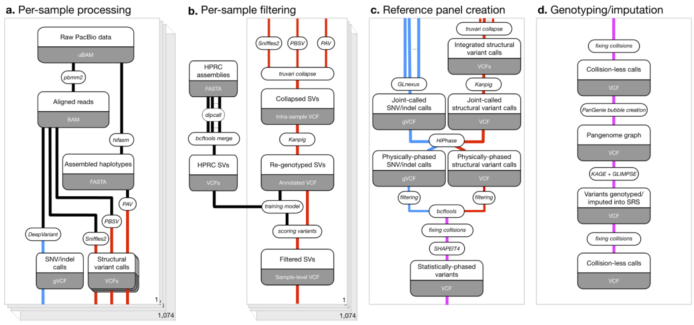

# All of Us Long Read Project, Phase 1

Phase 1 of AoU-LR comprises PacBio HiFi sequencing (~8×) of 1,027 participants who self-identified as Black or African American. The work covers per-sample alignment and assembly, multi-caller SV and small-variant discovery, cohort filtering and joint calling, a phased long-read reference panel, KAGE/GLIMPSE genotyping and imputation into short-read WGS (srWGS), and functional and clinical interpretation (including PheWAS).

To run the code, follow [GETTING_STARTED.md](../GETTING_STARTED.md).

## Pipeline

The figure covers stages **a–d**, from raw PacBio data to the collision-less imputed callset. Stage **e** covers the downstream analyses: associations, repeat expansions, figures, and tables.

| Stage | Description | Runs in |
|-------|-------------|---------|
| [a](PIPELINE.md#a-per-sample-processing) | Per-sample processing: align, assemble, call SNVs/indels and SVs | Terra |
| [b](PIPELINE.md#b-per-sample-filtering) | Per-sample SV filtering: collapse, re-genotype, score | Terra |
| [c](PIPELINE.md#c-reference-panel-creation) | Reference panel creation: joint call, phase, bubble graph | Terra |
| [d](PIPELINE.md#d-genotyping--imputation) | Genotyping and imputation into srWGS with KAGE and GLIMPSE | Terra |
| [e](PIPELINE.md#e-downstream-analyses--figures) | Downstream analyses, figures, and tables | Terra (callset QC), Researcher Workbench |

## Contents

| Path | Contents | Index |
|------|----------|-------|
| [PIPELINE.md](PIPELINE.md) | Stages a–e: inputs, outputs, workflows in order, and the matching Methods sections | — |
| [SOFTWARE.md](SOFTWARE.md) | Tool versions cited in the Methods, and the workflow or image that runs each tool | — |
| [terra/wdl/](terra/wdl/) | 43 WDL workflows, grouped by upstream repository | [terra/wdl/README.md](terra/wdl/README.md) |
| [terra/notebooks/](terra/notebooks/) | Callset QC notebooks (run in Terra) | [terra/notebooks/README.md](terra/notebooks/README.md) |
| [rw/notebooks/](rw/notebooks/) | Phenotype, figure, and table notebooks (run in Researcher Workbench) | [rw/notebooks/README.md](rw/notebooks/README.md) |
| [rw/scripts/AoU_SV_analysis/](rw/scripts/AoU_SV_analysis/) | CADD-SV plots, population summaries, eQTL, GWAS-catalog LD, PheWAS | [README.md](rw/scripts/AoU_SV_analysis/README.md) |

## Upstream repositories

The workflows are developed in the repositories below. This repository holds a copy of each workflow as it was run for Phase 1. The branch for each copy is in its `SOURCE.txt` and in [terra/wdl/README.md](terra/wdl/README.md).

| Repository | Role in Phase 1 |
|------------|-----------------|
| [broadinstitute/long-read-pipelines](https://github.com/broadinstitute/long-read-pipelines) | Assembly, small-variant calling, SV VCF merging, QC, joint gVCF calling |
| [broadinstitute/pav-wdl](https://github.com/broadinstitute/pav-wdl) | PAV assembly-based variant calling |
| [fabio-cunial/callset_integration](https://github.com/fabio-cunial/callset_integration) | Intra- and inter-sample SV merging, Kanpig re-genotyping, filtering |
| [fabio-cunial/sv-merging](https://github.com/fabio-cunial/sv-merging) | Truvari intrasample, joint calling, merge VCFs, overlap graph/stats |
| [broadinstitute/lrma-aou1-panel-creation](https://github.com/broadinstitute/lrma-aou1-panel-creation) | HiPhase physical phasing, SHAPEIT4 panel, KAGE, GLIMPSE, VCF merge |
| [broadinstitute/gatk-sv](https://github.com/broadinstitute/gatk-sv) | Cohort VCF QC (`MainVcfQc`) |
| [rlorigro/sv_merge](https://github.com/rlorigro/sv_merge) | SV overlap-graph evaluation |
